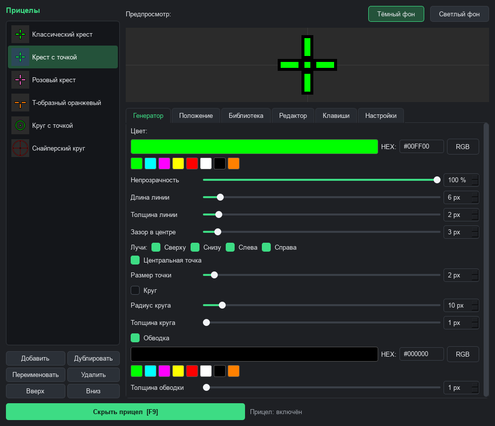
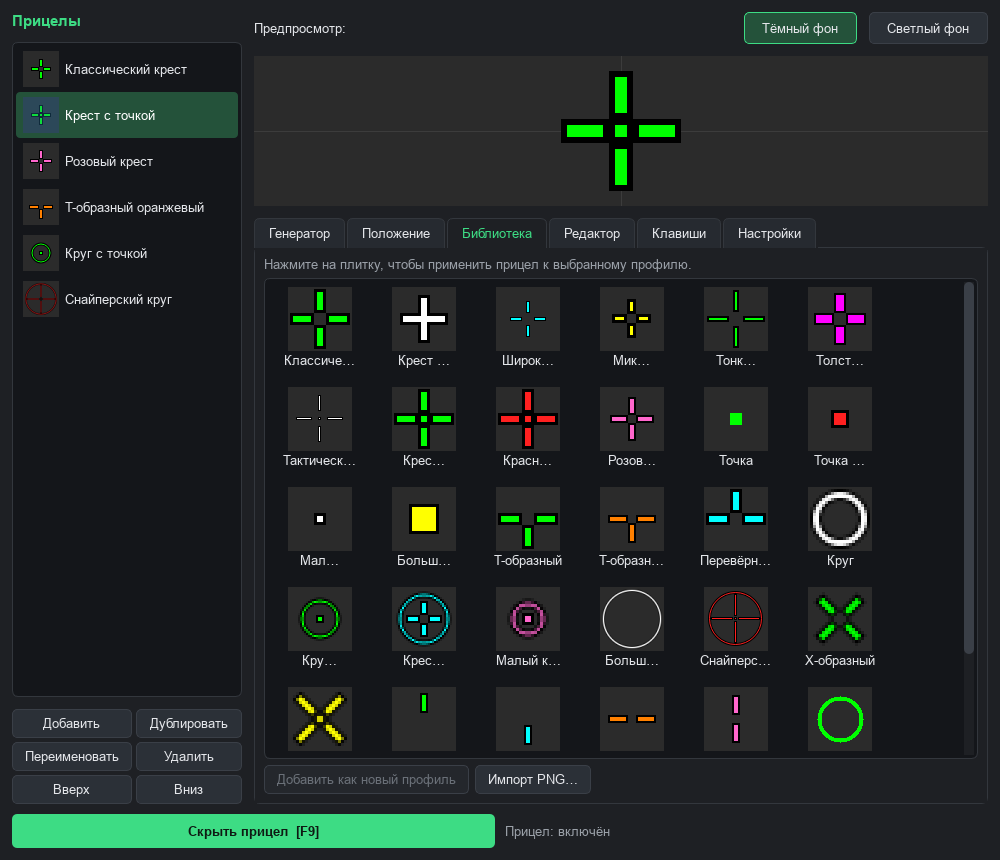
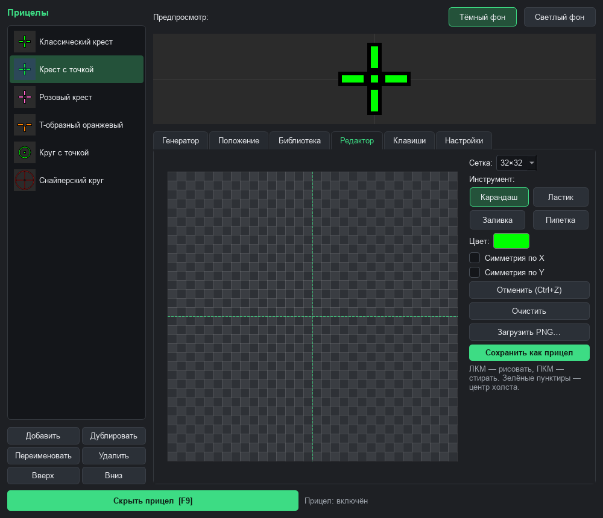
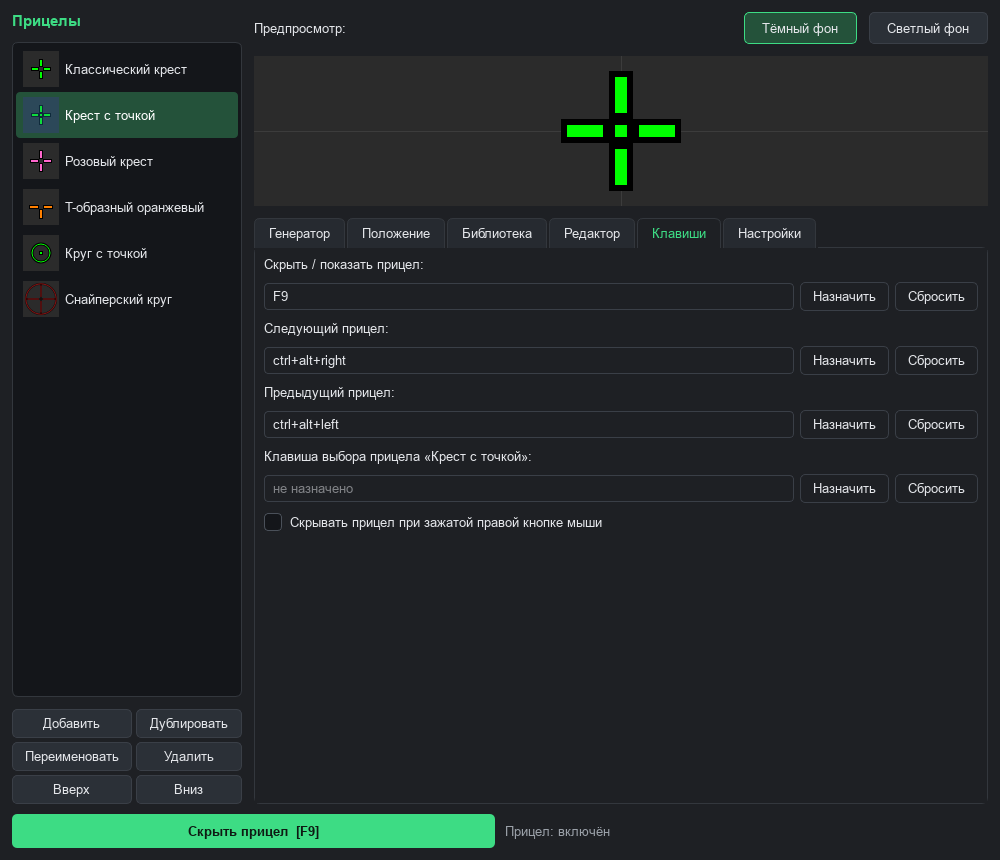

# CrosshairOverlay

Оверлей прицела для Windows. Рисует свой прицел по центру экрана поверх любой игры. В игру ничего не встраивается: прицел живёт в отдельном прозрачном окне, сквозь которое проходят клики мыши. Поэтому античиты его не трогают.

## Возможности

- **28 готовых прицелов**: кресты, точки, круги, T-образные, X-образные и другие.
- **Генератор**: собираешь прицел из частей. Длина и толщина лучей, зазор в центре, центральная точка, круг, обводка, цвет, прозрачность и поворот. Каждый луч (вверх, вниз, влево, вправо) включается отдельно.
- **Пиксельный редактор**: рисуешь прицел по пикселям. Есть карандаш, ластик, заливка, пипетка, симметрия по X и Y, отмена через Ctrl+Z.
- **Свои картинки**: можно загрузить любой PNG и перекрасить его в нужный цвет.
- **Профили**: сколько угодно прицелов в списке. Их можно переименовывать, дублировать, менять порядок и переключать горячими клавишами.
- **Обмен прицелами**: любой прицел копируется в виде текстового кода, а друг вставляет этот код у себя.
- **Несколько мониторов**: выбираешь, на каком мониторе показывать прицел. Положение можно сдвинуть от центра с точностью до пикселя.
- **Скрытие при прицеливании**: прицел прячется, пока зажата правая кнопка мыши (удобно в играх со своим прицелом в оптике).
- **Работа из трея**: окно настроек можно закрыть, программа останется в трее.

## Скриншоты

**Библиотека готовых прицелов.** Нажимаешь на плитку, и прицел применяется к выбранному профилю.

**Пиксельный редактор.** Рисуешь прицел по клеткам, зелёные пунктиры показывают центр.

**Горячие клавиши.** Включение, переключение прицелов и отдельная клавиша на каждый прицел.

## Горячие клавиши

| Действие | По умолчанию |
|---|---|
| Показать / скрыть прицел | `F9` |
| Следующий прицел | `Ctrl+Alt+→` |
| Предыдущий прицел | `Ctrl+Alt+←` |

Все клавиши меняются во вкладке «Клавиши». Там же можно назначить отдельную клавишу на любой прицел.

## Скачать

Всё лежит на странице [Releases](../../releases/latest). Нужен Windows 10 или 11.

**`CrosshairOverlay.exe`: обычная версия.** Скачал и запустил, установка не нужна. Видна поверх игр в оконном режиме и в режиме «Оконный без рамки».

**`CrosshairOverlay-fullscreen.zip`: версия для полноэкранных игр.**

1. Распакуй архив в любую папку.
2. Запусти `install.bat` и разреши изменения (нужны права администратора).
3. Дождись надписи «Готово» и закрой окно.
4. Запускай прицел ярлыком CrosshairOverlay с рабочего стола или из меню «Пуск».

Установщик делает четыре вещи:

1. создаёт на твоём компьютере сертификат для подписи и добавляет его в доверенные Windows;
2. копирует программу в `C:\Program Files\CrosshairOverlay`;
3. подписывает exe;
4. создаёт ярлыки на рабочем столе и в меню «Пуск».

Чтобы удалить всё вместе с сертификатом, запусти `uninstall.bat` из того же архива.

Windows может показать предупреждение SmartScreen «Windows защитил ваш компьютер»: программа не подписана платным сертификатом. Нажми «Подробнее», потом «Выполнить в любом случае».

## Почему прицел может быть не виден в полноэкранном режиме

Обычное окно «поверх всех» полноэкранная игра перекрывает. Поэтому программа создаёт окно прицела в особом слое Windows **UIAccess**. В этом же слое работают экранная лупа и экранная клавиатура, он выше всех обычных окон. Windows пускает туда только подписанные программы из `Program Files`, для этого и нужен скрипт установки.

Проверить, что слой включился: наведи мышь на значок прицела в трее. Если в подсказке просто `CrosshairOverlay`, всё работает. Если там `CrosshairOverlay (обычный режим)`, программа запущена не через установленный ярлык (или это обычная версия).

Есть случай, который не обходится ничем, кроме встраивания в игру: **эксклюзивный полноэкранный режим**. В нём игра выводит картинку прямо на монитор, мимо Windows, и поверх неё не видно вообще никаких окон. Что делать:

- **Поставь в игре режим «Оконный без рамки»** (Borderless / Windowed Fullscreen). Это самый надёжный вариант.
- **Игры на DirectX.** Проверь, что у exe игры не отключена полноэкранная оптимизация: правый клик по exe, «Свойства», «Совместимость», галочка «Отключить оптимизацию во весь экран» должна быть снята.
- **Игры на OpenGL или Vulkan** (например, игры на Java), если видеокарта NVIDIA. Открой NVIDIA App (или «Панель управления NVIDIA»), раздел «Графика», затем «Настройки программы». Добавь игру и поставь «Метод презентации Vulkan/OpenGL» в значение «Предпочитать слоистый на цепочке переключения DXGI» (Prefer layered on DXGI Swapchain).

## Где хранятся настройки

`%APPDATA%\CrosshairOverlay\config.json`: профили, клавиши и остальные настройки. Свои картинки и прицелы из редактора лежат в `%APPDATA%\CrosshairOverlay\custom`.
